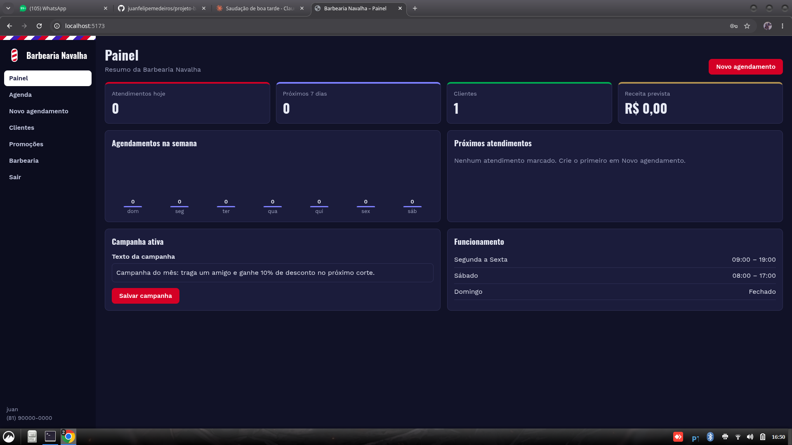
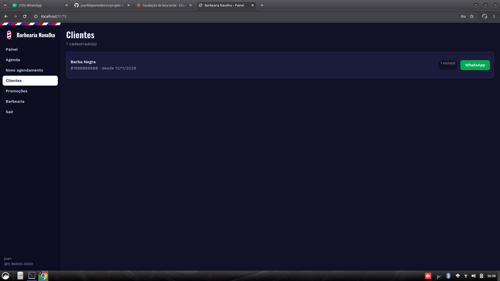
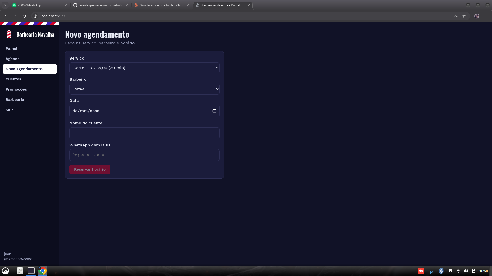
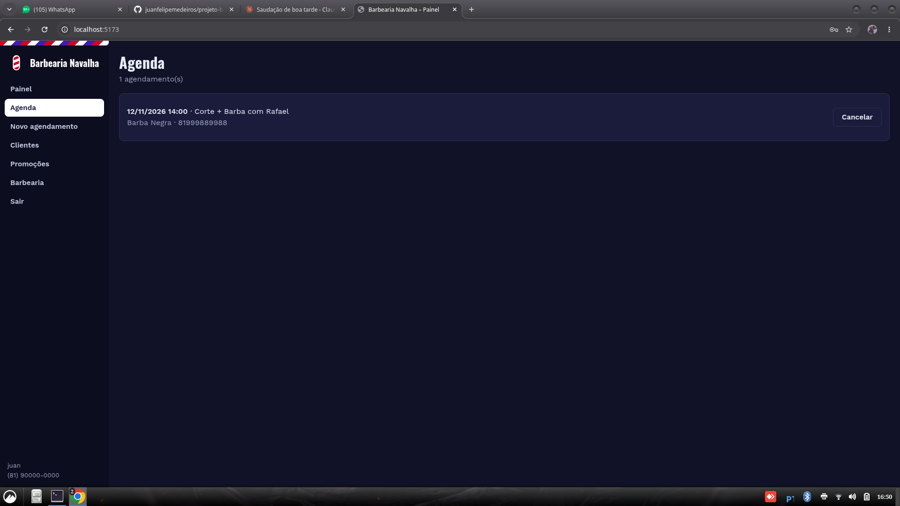
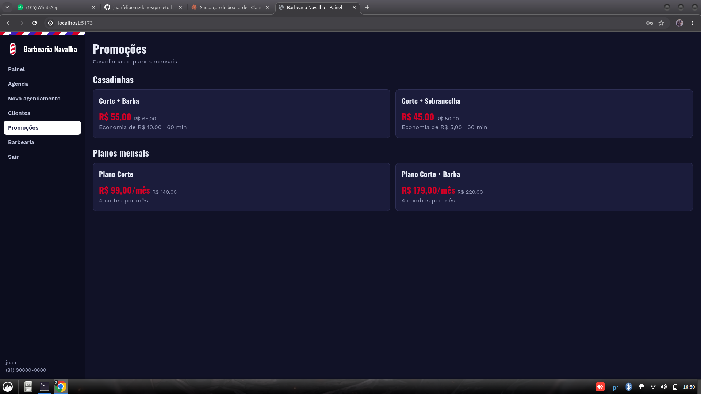
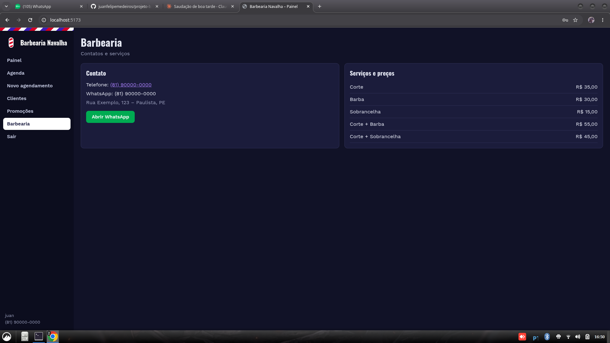

# Sistema da Barbearia

Painel de gestão para barbearia: agendamentos, clientes, serviços e combos, planos mensais, horários de funcionamento e campanha do mês, com login de administrador.

- **Site (front-end):** React + Vite
- **Servidor (API):** Python + Flask
- **Banco de dados:** MariaDB

## Estrutura do projeto

```
projeto-barbearia/
├── api/          servidor Flask (login, clientes, agendamentos, serviços...)
├── barbearia/    site em React + Vite
└── sql/          scripts do banco de dados
```

## O que o sistema faz

- Login e logout do administrador
- Painel com resumo da semana, receita prevista e campanha ativa
- Agenda com cancelamento de horários
- Novo agendamento por serviço, barbeiro e data, mostrando só os horários livres
- Cadastro automático de clientes e link direto para o WhatsApp
- Serviços, casadinhas (combos) e planos mensais
- Dados da barbearia e horários de funcionamento

## Requisitos

- Python 3
- Node.js e npm
- MariaDB

## Como rodar

### 1. Banco de dados

Antes, abra o arquivo `sql/barbearia.sql` e troque `troque_esta_senha` por uma senha sua. Depois, na pasta do projeto, rode na ordem:

```
sudo mariadb < sql/barbearia.sql
sudo mariadb < sql/migracao.sql
sudo mariadb < sql/dados_iniciais.sql
```

O `barbearia.sql` cria o banco, o usuário `barbearia_app` e as tabelas. O `migracao.sql` acrescenta a tabela de barbeiros e colunas extras. O `dados_iniciais.sql` cadastra serviços, planos, horários e barbeiros de exemplo (troque pelos dados reais da barbearia).

### 2. Servidor (API)

```
cd api
python3 -m venv venv
source venv/bin/activate
pip install -r requirements.txt
python criar_admin.py
python app.py
```

O `criar_admin.py` pergunta o nome, o e-mail e a senha do administrador. O servidor sobe em `http://localhost:5001`.

Se usou outra senha para o banco, informe por variável de ambiente antes de iniciar:

```
export DB_SENHA="sua_senha"
export SECRET_KEY="uma-chave-longa-e-secreta"
```

Também são aceitas `DB_HOST` e `DB_USUARIO`.

### 3. Site

Em outro terminal:

```
cd barbearia
npm install
npm run dev
```

Abra `http://localhost:5173` no navegador e entre com o administrador criado no passo anterior. Use sempre `localhost`, e não `127.0.0.1`, senão o login não funciona.

## Observações

- O painel é só para o administrador. Contas de cliente veem "Acesso restrito".
- A API aceita requisições do site apenas em `http://localhost:5173`.
- Os dados de `sql/dados_iniciais.sql` são exemplos. Para trocar pelos reais, edite o arquivo antes de rodar ou use comandos `UPDATE`.
- Não coloque senhas reais dentro do código nem no repositório. Use variáveis de ambiente.

## Telas do sistema

### Painel


### Agenda


### Novo agendamento


### Clientes


### Promoções


### Barbearia

